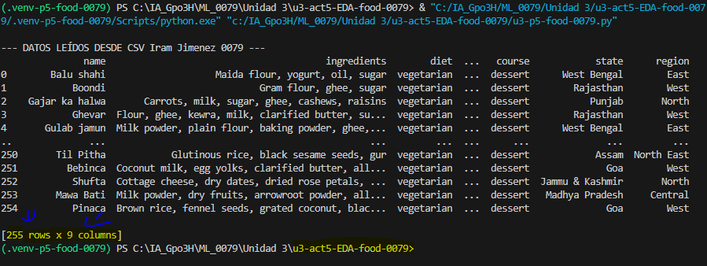
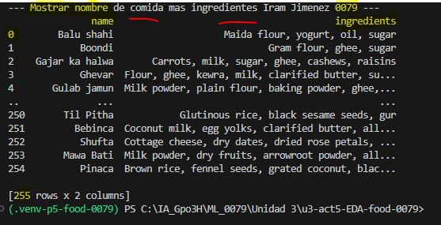
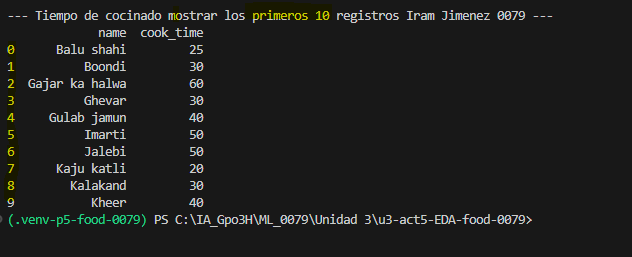
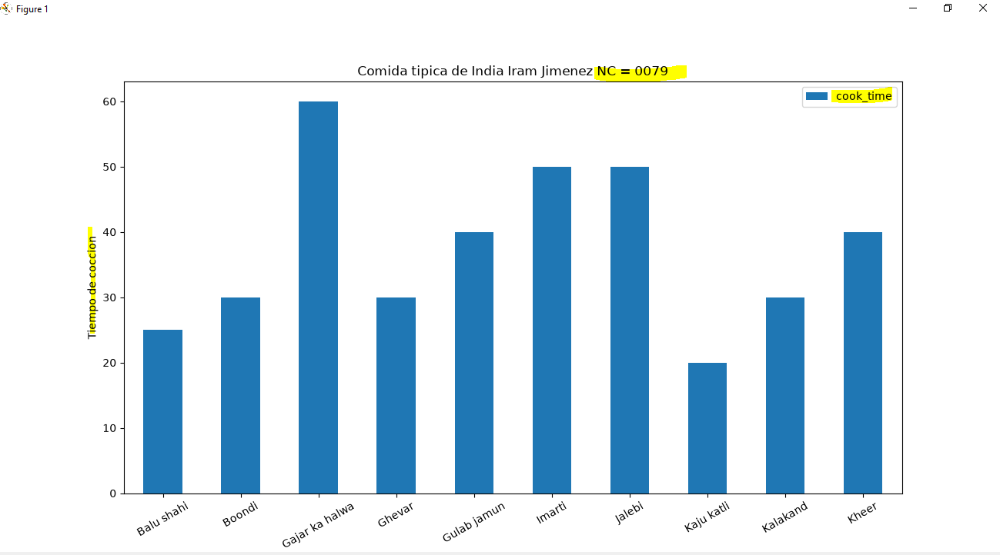
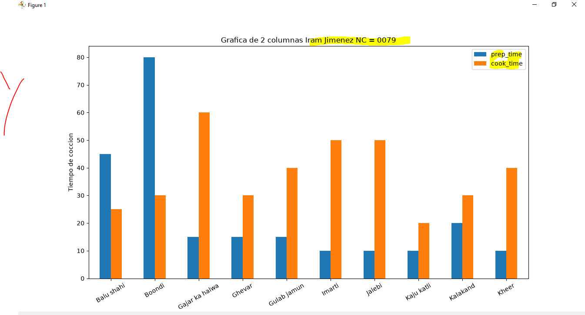
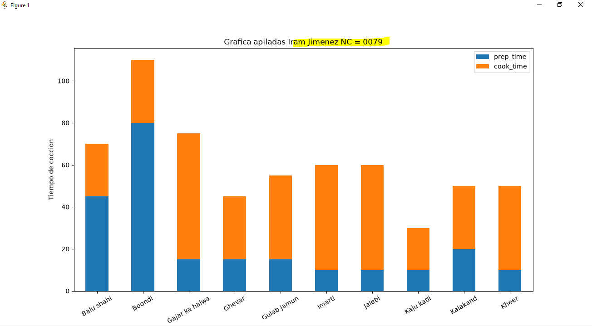

## Analisis exploratorio de datos
## Comida del pais India
## Iram Jimenez NC = 0079
### +-+-+ Importando datos del csv comida de India +-+-+

### +-+-+ Mostrar nombre comida mas ingredientes +-+-+

#### Tiempo de coccion mostrar los primeros 10 registros

## Creacion de graficas de barras 0079

## Grafica de varias columnas 0079

## Grafica de columnas apiladas verticalmente una tras otra
